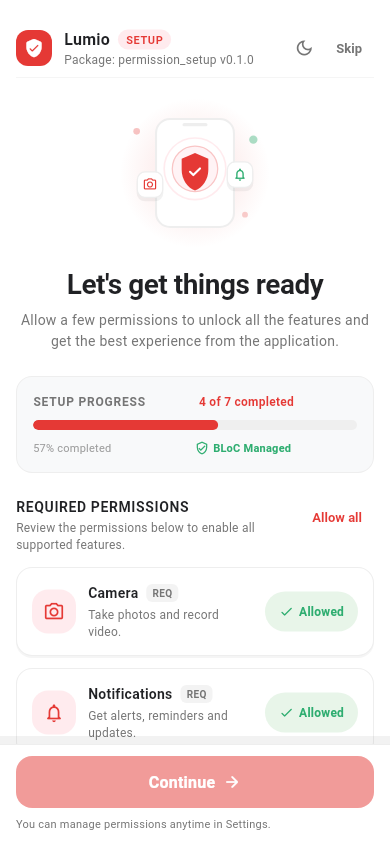
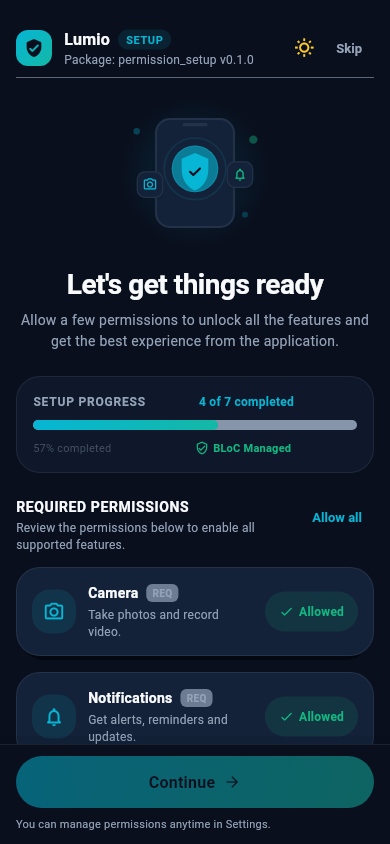
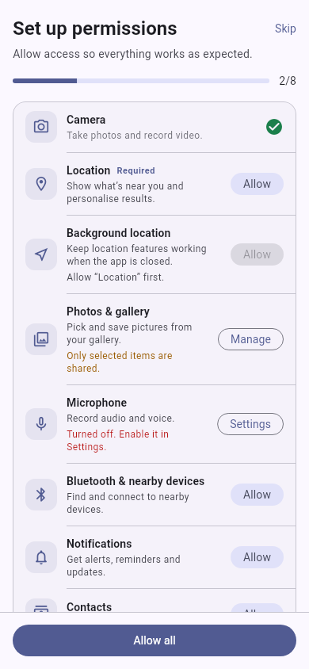
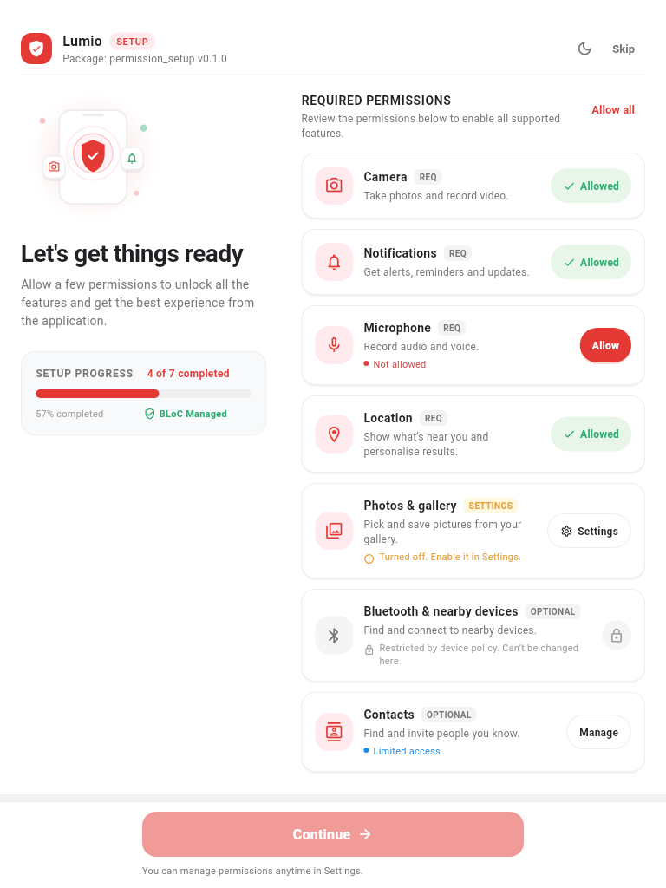
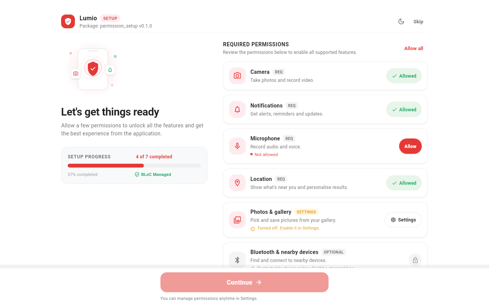
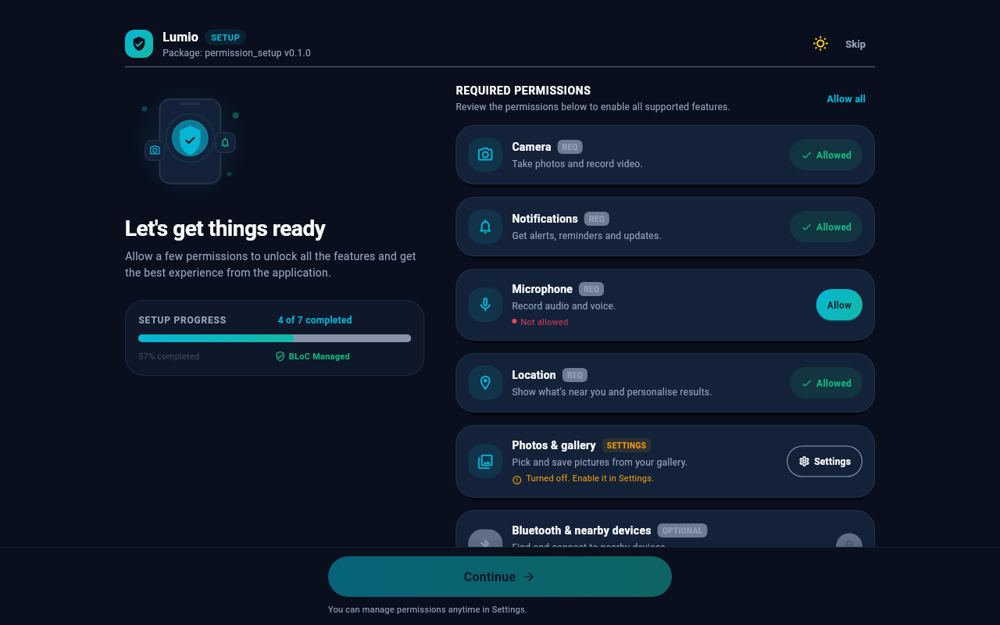
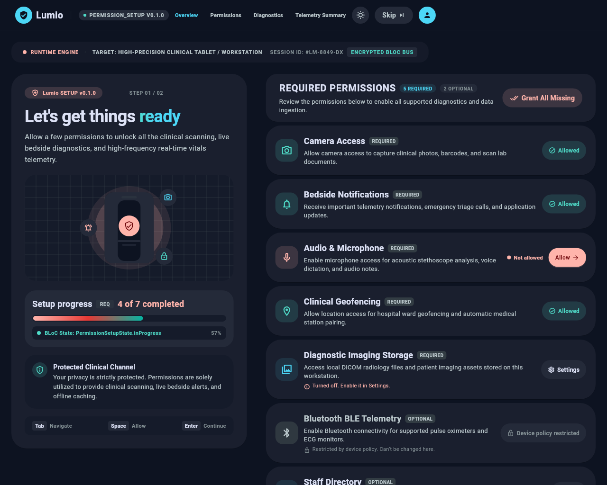
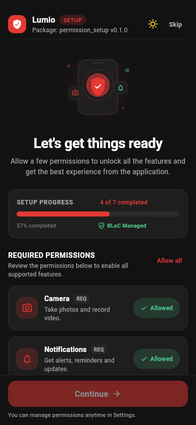

# play_permission_setup

[](https://pub.dev/packages/play_permission_setup)
[](https://pub.dev/packages/play_permission_setup/score)
[](LICENSE)
[](#platform-support)

A **permission setup screen** for Flutter that is ready to ship, plus a **command line tool that audits the
files where permissions are declared** (`AndroidManifest.xml`, `Info.plist`, macOS entitlements, the iOS `Podfile`).

|  | Crimson look | Clinical look | Classic look |
|---|---|---|---|
| Phone |  |  |  |

<p align="center">
  
  
  
</p>
<p align="center">
  
</p>

---

## Contents

1. [Features](#features)
2. [Why this package?](#why-this-package)
3. [When to use it (and when not to)](#when-to-use-it-and-when-not-to)
4. [Platform support](#platform-support)
5. [Getting started](#getting-started)
6. [Usage](#usage)
7. [The command line tool](#the-command-line-tool)
8. [Customisation](#customisation)
9. [Using the BLoC directly](#using-the-bloc-directly)
10. [API reference](#api-reference)
11. [Responsive behaviour](#responsive-behaviour)
12. [Edge cases handled](#edge-cases-handled)
13. [Accessibility](#accessibility)
14. [Testing your app](#testing-your-app)
15. [Recipes](#recipes)
16. [Troubleshooting / FAQ](#troubleshooting--faq)
17. [Limitations](#limitations)
18. [Additional information](#additional-information)

---

## Features

* **One screen for many permissions.** Shows each permission with its status and the right button (*Allow*,
  *Settings*, *Manage*), a progress card and a *Continue* button that unlocks when the required ones are granted.
* **Two finished designs** (`crimson`, `clinical`) plus a compact classic list. Light **and** dark. Every colour, radius,
  font, text and switch can be changed.
* **Responsive.** One widget for phones, tablets and desktop windows. The layout follows the space it is given, so it
  also works in a dialog or a side panel. Right-to-left, large text and dark mode are supported.
* **Scans itself.** No permission list to write: on Android and iOS the page reads what the installed app really
  declares (merged `AndroidManifest.xml`, `Info.plist`) and shows exactly that. Nothing is hard-coded.
* **A build-time audit (CLI)** that reads your platform files, **reports mistakes** (missing usage strings, missing
  Podfile macros, partial Bluetooth, ...) and can still **generate** a fixed list if you prefer one.
* **Driven by a BLoC** you can use directly to build your own UI.
* **Handles the awkward cases for you:** *permanently denied*, *restricted*, *limited photos*, *GPS off*, *background
  location order*, *Android-version differences*, double taps, failed requests and more.
* **Fully testable.** The platform is behind a small `PermissionService` interface you can fake.

## Why this package?

[`permission_handler`](https://pub.dev/packages/permission_handler) gives you the *calls*. It does not give you:

| Missing piece | What goes wrong without it |
|---|---|
| **A screen** | Every app rebuilds the same list-of-permissions page, then hand-codes "denied", "open settings" and "come back from settings". |
| **A safety net for platform files** | If `NSCameraUsageDescription` is missing, iOS **kills your app** the moment you ask for the camera. If the `PERMISSION_CAMERA=1` Podfile macro is missing, iOS silently answers "denied". A blank usage string gets the app **rejected in App Store review**. |
| **The ordering and edge-case logic** | Background location must be requested *after* foreground location. Storage permission is meaningless on Android 13+. Bluetooth is two permissions on Android 12+. |

`play_permission_setup` reads your real platform files at build time, **tells you what is wrong**, generates the list of
permissions your app really declares, and shows a screen for exactly those permissions.

## When to use it (and when not to)

**Good fit**

* An onboarding or "get set up" step that asks for **several** permissions at once.
* A **Permissions** page in your app's settings where users can review and fix access.
* Apps shipped on several platforms that need one consistent flow.
* CI checks that catch missing usage descriptions *before* App Store review.

**Not the best fit**

* You ask for **one** permission, **exactly when the feature is used**. That is the best practice for most apps. Call
  `PermissionHandlerService().request(PermissionKind.camera)` (see [the recipe](#ask-for-one-permission-exactly-when-it-is-needed))
  or `permission_handler` directly. You can still use the CLI for the audit.
* You need a permission that is not in the [catalogue](#permission-catalogue). Plug in a [custom service](#custom-service).

> **Store-review tip.** Apple and Google prefer permission requests that are explained and happen in context. Use this
> page for permissions the user will expect to grant up front (for example notifications or camera for a scanner app),
> and write a real explanation for each one (`description` and `rationale`).

## Platform support

| Android | iOS | Web | Windows | macOS | Linux |
|:---:|:---:|:---:|:---:|:---:|:---:|
| ✅ | ✅ | ⚠️ | ⚠️ | ⚠️ | ⚠️ |

* ✅ **Full support.** The screen, **automatic scanning** and real permission requests all work.
* ⚠️ **Partial.** The **screen renders and never crashes**, but what it can *request* depends on
  [`permission_handler`](https://pub.dev/packages/permission_handler) 12, which:
  * has **limited** permission support on **web** and **Windows** (only a few permissions are implemented);
  * has **no implementation for macOS or Linux**. Permissions there are shown as *not needed* and are not requested.
    The scanner still **audits your macOS files** (Info.plist and entitlements), so you can use it as a check even
    though the system prompts come from your own code or a custom service.

  To request permissions on macOS or Linux, plug in your own [`PermissionService`](#custom-service).

**Requirements:** Dart `^3.8.0`, Flutter `>=3.32.0`.

---

## Getting started

### 1. Install

```bash
flutter pub add play_permission_setup
```

or add it to `pubspec.yaml`:

```yaml
dependencies:
  play_permission_setup: ^0.2.1
```

### 2. Declare the permissions the normal way

Permissions must still be declared in each platform's files. See the [platform setup](#platform-setup) below. You do
**not** have to get this perfect by hand: step 3 checks it for you.

### 3. Show the page: it scans by itself

```dart
import 'package:flutter/material.dart';
import 'package:play_permission_setup/play_permission_setup.dart';

class Gate extends StatelessWidget {
  const Gate({super.key});

  @override
  Widget build(BuildContext context) {
    void goHome(PermissionSetupState _) => Navigator.of(context)
        .pushReplacement(MaterialPageRoute(builder: (_) => const Home()));

    return PermissionSetupPage(
      // No list! The page reads what your app declares and shows exactly that.
      detection: const PermissionDetection(
        requiredKinds: {PermissionKind.camera}, // these block "Continue"
      ),
      style: PermissionSetupStyle.crimson, // or .clinical, or your own
      onComplete: goHome,                  // required permissions granted + Continue
      onSkip: goHome,                      // shows "Skip"
      autoCompleteWhenSatisfied: true,     // never show the page if nothing is left to ask
      autoRequest: true,                   // open the system dialogs one after another, no tap needed
    );
  }
}
```

That is the whole integration. Add a permission to `AndroidManifest.xml` or `Info.plist` and it appears on the page;
remove it and it disappears. See [Automatic scanning](#automatic-scanning) for what is detected and the edge cases.

### 4. (Optional) Audit your platform files

The scanner at run time tells you *what is declared*. The command line tool tells you *whether it is declared
correctly* (blank iOS texts, missing Podfile macros, entitlements in only one build type, ...):

```bash
dart run play_permission_setup scan --strict     # audit; put this in CI
```

It can also write a fixed list for you (`dart run play_permission_setup generate`), but that is optional. See
[the command line tool](#the-command-line-tool).

### Platform setup

`permission_handler` needs the usual native setup. Add only the permissions you use. The CLI verifies all of the
following (`dart run play_permission_setup scan`).

<details>
<summary><b>Android</b> – <code>android/app/src/main/AndroidManifest.xml</code></summary>

```xml
<uses-permission android:name="android.permission.CAMERA"/>
<uses-permission android:name="android.permission.ACCESS_FINE_LOCATION"/>
<uses-permission android:name="android.permission.ACCESS_BACKGROUND_LOCATION"/>
<uses-permission android:name="android.permission.READ_MEDIA_IMAGES"/>
<uses-permission android:name="android.permission.POST_NOTIFICATIONS"/>
<!-- Android 12+ needs both -->
<uses-permission android:name="android.permission.BLUETOOTH_SCAN"/>
<uses-permission android:name="android.permission.BLUETOOTH_CONNECT"/>
<!-- legacy gallery access for Android 12 and below -->
<uses-permission android:name="android.permission.READ_EXTERNAL_STORAGE" android:maxSdkVersion="32"/>
```
</details>

<details>
<summary><b>iOS</b> – <code>ios/Runner/Info.plist</code> (explain <i>why</i>; blank strings are rejected by Apple)</summary>

```xml
<key>NSCameraUsageDescription</key>
<string>Take photos for your profile.</string>
<key>NSLocationWhenInUseUsageDescription</key>
<string>Show places near you.</string>
<key>NSLocationAlwaysAndWhenInUseUsageDescription</key>
<string>Track trips while the app is in the background.</string>
<key>NSPhotoLibraryUsageDescription</key>
<string>Choose pictures from your library.</string>
<key>NSBluetoothAlwaysUsageDescription</key>
<string>Connect to your accessories.</string>
```
</details>

<details>
<summary><b>iOS</b> – <code>ios/Podfile</code> (required by <code>permission_handler</code>; without it iOS always reports "denied")</summary>

```ruby
post_install do |installer|
  installer.pods_project.targets.each do |target|
    flutter_additional_ios_build_settings(target)
    target.build_configurations.each do |config|
      config.build_settings['GCC_PREPROCESSOR_DEFINITIONS'] ||= [
        '$(inherited)',
        'PERMISSION_CAMERA=1',
        'PERMISSION_LOCATION=1',
        'PERMISSION_PHOTOS=1',
        'PERMISSION_NOTIFICATIONS=1',
        'PERMISSION_BLUETOOTH=1',
      ]
    end
  end
end
```

Then run `cd ios && pod install`.
</details>

<details>
<summary><b>macOS</b> – <code>macos/Runner/DebugProfile.entitlements</code> <b>and</b> <code>Release.entitlements</code></summary>

```xml
<key>com.apple.security.device.camera</key><true/>
<key>com.apple.security.device.audio-input</key><true/>
<key>com.apple.security.personal-information.location</key><true/>
```

Add the entitlement to **both** files, and add the matching `NS…UsageDescription` keys to `macos/Runner/Info.plist`.
</details>

The full mapping of each permission to its manifest permission, plist key, Podfile macro and entitlement is in the
[permission catalogue](#permission-catalogue).

---

## Usage

### The minimum

```dart
PermissionSetupPage(
  onComplete: (state) => goHome(),   // scans the app, shows what it declares
)
```

### Automatic scanning

When you do **not** pass `items:`, the page scans the running app once, shows a spinner for a moment, then lists
exactly the permissions the app declares.

| Platform | What is read |
|---|---|
| **Android** | The **merged** manifest (`uses-permission`), so permissions added by other plugins are included. |
| **iOS** | The `NS…UsageDescription` keys in `Info.plist` that have a **non-blank** text, and `UIBackgroundModes` (for push). |
| Web, Windows, macOS, Linux | Cannot be scanned. The page shows your `fallbackItems`, or "Nothing to set up". |

Configure it with `PermissionDetection`:

```dart
PermissionSetupPage(
  detection: PermissionDetection(
    requiredKinds: {PermissionKind.camera, PermissionKind.location}, // block Continue
    excludeKinds: {PermissionKind.contacts},       // declared, but never show it
    includeKinds: {PermissionKind.notification},   // show even if undetectable (iOS)
    overrides: {                                   // your own texts, icon, rationale
      PermissionKind.camera: PermissionItem(
        kind: PermissionKind.camera,
        title: 'Scan receipts',
        description: 'We only use the camera to scan paper receipts.',
      ),
    },
    fallbackItems: [PermissionItem(kind: PermissionKind.camera)], // when it cannot scan
    onResult: (r) => debugPrint('${r.items.length} permissions, ${r.warnings}'),
  ),
)
```

| Option | Default | Meaning |
|---|---|---|
| `requiredKinds` | none | Block *Continue* until granted. Everything else is optional. |
| `excludeKinds` | none | Hide declared kinds. Wins over everything else. |
| `includeKinds` | none | Show kinds the platform cannot reveal (iOS notifications have no plist key). Ignored for kinds the platform does not support. |
| `overrides` | none | Replace title / description / icon / rationale per kind. Its own `isRequired` is kept unless the kind is in `requiredKinds`. |
| `fallbackItems` | empty | Used when the platform cannot be scanned. |
| `detector` | native scanner | Replace to fake the platform in tests. |
| `timeout` | 5 s | Stop scanning and use the fallback after this long. |
| `onResult` | none | Receives the `DetectionResult` (`items`, `warnings`, `scanned`, `declaredKinds`). |
| `logWarnings` | `true` | Print warnings in debug mode. |

**Edge cases the scanner handles**

| Situation | What happens |
|---|---|
| Unknown or foreign permissions (`INTERNET`, vendor permissions) | Ignored. |
| `android.permission.CAMERA` vs `CAMERA`, duplicates, blanks | Normalised. |
| Only `BLUETOOTH_SCAN` declared (no `CONNECT`) | Hidden, with a warning, because it would not work on Android 12+. |
| `ACCESS_BACKGROUND_LOCATION` without foreground location | Location is added (it has to be granted first) and you get a warning. |
| A `requiredKinds` entry that is not declared | Not shown (it cannot be requested) and you get a warning. |
| Blank iOS usage text | Treated as not declared (Apple rejects it). The CLI reports it. |
| iOS notifications | Detected through `remote-notification` in `UIBackgroundModes`; otherwise use `includeKinds`. |
| Scanning throws, times out, or the plugin is missing | Never crashes. Falls back to `fallbackItems` and records a warning. |
| Nothing declared | "Nothing to set up" state. |
| A parent rebuilds with an *equal* `PermissionDetection` | No rescan. A *changed* configuration rescans. |
| The page is closed while scanning | Safe, no exceptions. |
| You pass `items:` or `bloc:` | No scan; you stay in full control. |

> **Limit.** `Info.plist` and the merged manifest are readable at run time, but iOS **Podfile macros are compile-time
> flags** and cannot be read. A missing `PERMISSION_CAMERA=1` makes iOS answer "denied" without a dialog. The CLI audit
> (`dart run play_permission_setup scan`) catches it, so keep it in CI.

For a custom UI, scan yourself:

```dart
// One-off, e.g. in a Cubit or a test:
final result = await detectPermissions(const PermissionDetection(requiredKinds: {PermissionKind.camera}));
// result.items, result.warnings, result.scanned

// Or with the ready-made Cubit (state: loading / ready(result)):
BlocProvider(create: (_) => PermissionDetectionCubit(const PermissionDetection()), child: ...);
```

### Describe your permissions

Titles, icons and descriptions have sensible defaults. Override them (through `PermissionDetection.overrides`, or in a
hand-written `items:` list) so the screen explains **why *your* app needs each permission**:

```dart
const items = [
  PermissionItem(
    kind: PermissionKind.camera,
    title: 'Scan receipts',
    description: 'We use the camera only to scan paper receipts.',
    rationale: 'Without camera access you can still add receipts manually.',
    icon: Icons.document_scanner_outlined,
    isRequired: true,
  ),
  PermissionItem(kind: PermissionKind.notification, isRequired: false),
];
```

| Field | Purpose |
|---|---|
| `kind` | Which permission (required). See the [catalogue](#permission-catalogue). |
| `title`, `description`, `icon` | Override the defaults. |
| `rationale` | Extra line shown **after the user has denied it**, e.g. what they lose. |
| `isRequired` | `true` (default) blocks **Continue** until granted. `false` makes it optional. |
| `platforms` | Platforms where it applies. `null` means every platform the kind supports. The generated list sets this from your manifest. |

### Required vs optional

* **Required** items block *Continue* until they are satisfied (*granted*, *limited*, *provisional* or *not applicable*).
* **Optional** items never block. The user can leave them denied.
* If a required item is **restricted** (parental controls, MDM) it can never be fixed in the app. The page then
  explains this instead of leaving *Continue* silently disabled.
* Mark things required only when the app really cannot work without them.

### The flows

| Flow | How |
|---|---|
| **Onboarding gate** (first launch) | `onComplete` and `onSkip` go to home. `autoCompleteWhenSatisfied: true` skips the page when nothing is missing. |
| **Settings page** (review and fix) | Add `appBar:`, no `onSkip`. See the [recipe](#a-permissions-page-inside-your-settings). |
| **Dialog / side panel** (desktop) | Put the page in a `Dialog`. See the [recipe](#show-the-page-in-a-dialog-desktop--tablet). |
| **Just in time** (best practice for single permissions) | Skip the page. Use [`PermissionHandlerService`](#ask-for-one-permission-exactly-when-it-is-needed). |

### Callbacks

| Callback | Fires when |
|---|---|
| `onComplete(state)` | All required permissions are satisfied **and** the user pressed *Continue* (or immediately with `autoCompleteWhenSatisfied`). Fires once. |
| `onSkip(state)` | The user tapped *Skip*. The Skip button appears when this is set (or `allowSkip: true`). |

---

## The command line tool

The page already scans your app at run time (see [Automatic scanning](#automatic-scanning)). The command line tool is an
**audit**: it reads the source files at **build time** and checks they are declared *correctly*.

```bash
dart run play_permission_setup scan     [--path .] [--strict]
dart run play_permission_setup generate [--path .] [--output lib/play_permission_setup.g.dart]
                                   [--required camera,location] [--exclude sms]
```

| Option | Meaning |
|---|---|
| `--path`, `-p` | Flutter app root. Default: the nearest parent folder that is a Flutter app. |
| `--output`, `-o` | File to write for `generate`. Default `lib/play_permission_setup.g.dart`. |
| `--required` | Kinds that block **Continue** until granted. Everything else is optional. |
| `--exclude` | Kinds to leave out of the generated list. |
| `--strict` | Exit with code `1` on **warnings** too (use in CI). |
| `--help`, `-h` | Print usage. |

**Exit codes:** `0` clean (or only warnings), `1` errors (or warnings with `--strict`), `64` bad arguments.

Example report:

```text
Permission           android ios     macos
camera               yes     yes     yes
location             yes     yes     yes
notification         yes     MISSING MISSING

ERROR [ios] NSLocationAlwaysAndWhenInUseUsageDescription requires NSLocationWhenInUseUsageDescription too.
WARN  [ios · ios/Runner/Info.plist] NSCalendarsFullAccessUsageDescription is empty. Apple rejects apps with blank usage descriptions.
WARN  [macos] microphone: entitlement is only in DebugProfile – add it to both DebugProfile and Release.
```

### What it checks

| Area | Check |
|---|---|
| Android | `uses-permission` and `uses-permission-sdk-23`; `tools:node="remove"`; flavour manifests (`src/<flavor>/`); partial Bluetooth (SCAN without CONNECT); legacy storage on Android 13+; background location without foreground |
| iOS | Usage keys present; **blank** usage strings; Podfile macro missing, commented out or `=0`; key without macro; macro without key; Always-location without When-in-use; binary plists |
| macOS | Usage keys; sandbox entitlements present in **both** Debug and Release |
| Cross-platform | A permission declared on one platform but not another (it will be hidden there) |

**Why the generated file matters.** Each generated item carries the platforms where it is *actually declared*, so the
page never asks for something on a platform where it would crash or silently fail.

### Run it in CI

```yaml
# .github/workflows/permissions.yml
name: permissions
on: [pull_request]
jobs:
  audit:
    runs-on: ubuntu-latest
    steps:
      - uses: actions/checkout@v4
      - uses: subosito/flutter-action@v2
        with: { channel: stable }
      - run: flutter pub get
      - run: dart run play_permission_setup scan --strict
```

Add the same command to a pre-commit hook or your release checklist. To catch a stale generated file, re-run `generate`
in CI and fail if `git diff --exit-code lib/play_permission_setup.g.dart` is not empty.

You can also install the tool globally: `dart pub global activate play_permission_setup`, then `play_permission_setup scan`.

---

## Customisation

Four levels. Use only as much as you need.

| Level | You change | How |
|---|---|---|
| 1. Content | Titles, descriptions, icons, required or not | [`PermissionItem`](#describe-your-permissions) |
| 2. Look and text | Colours, shapes, fonts, layout, every label | [`PermissionSetupStyle`](#style-reference) and [`PermissionSetupStrings`](#strings-reference) |
| 3. Parts | Header, rows, footer, empty and loading states | [builders](#level-3-replace-parts) |
| 4. Everything | The whole UI, keeping the logic | [`PermissionSetupBuilder`](#level-4-build-everything-yourself) |

### Ready-made looks (presets)

Two complete designs ship in the box. Both follow light/dark and every part can be tuned.

<p align="center">
  
  
  
</p>

| Preset | Character | Dark mode |
|---|---|---|
| `PermissionSetupStyle()` | Compact grouped list that follows your `ThemeData` | Follows the app theme |
| `PermissionSetupStyle.crimson` | White, red accent, hero illustration, one card per permission, glowing Continue button | Has its own dark variant |
| `PermissionSetupStyle.clinical` | Deep navy, teal gradient, 24 px corners, pill buttons | Dark by design |
| `PermissionSetupStyle.workstation` | Desktop workstation: top bar with navigation, big left panel, panel rows | Dark by design |

```dart
PermissionSetupPage(
    style: PermissionSetupStyle.crimson,
  onToggleTheme: () => toggleMyTheme(),   // shows a moon / sun button
  brand: const PermissionSetupBrand(
    appName: 'MyApp',
    badge: 'Setup',
    caption: 'Version 1.0',
  ),
  strings: const PermissionSetupStrings(
    title: "Let's get things ready",
    subtitle: 'Allow a few permissions to unlock all the features.',
    progressBadge: 'Secured',             // hidden when null
    footerNote: 'You can change this anytime in Settings.',
  ),
  onComplete: goHome,
  onSkip: goHome,
)
```

### Different look on desktop (Windows, macOS, Linux, web)

Give the page a second style for desktop operating systems and wide web windows. Phones and tablets keep `style`:

```dart
PermissionSetupPage(
  style: PermissionSetupStyle.crimson,             // Android, iOS
  desktopStyle: PermissionSetupStyle.workstation,  // Windows, macOS, Linux, wide web
  brand: const PermissionSetupBrand(
    appName: 'Lumio',
    chip: 'play_permission_setup v0.1.0',               // status pill after the name
    navItems: ['Overview', 'Permissions', 'Diagnostics'],
    activeNavIndex: 0,
    onNavSelected: (i) => go(i),
  ),
  topBanner: PermissionSetupMetaBar(               // optional slim status strip
    style: PermissionSetupStyle.workstation,
    leading: 'Runtime engine',
    trailing: 'Session #42',
  ),
  bottomBanner: PermissionSetupMetaBar(
    style: PermissionSetupStyle.workstation,
    leading: 'Core running',
  ),
  strings: const PermissionSetupStrings(
    title: "Let's get things ready",
    titleHighlight: 'ready',                       // painted with the gradient
    heroBadge: 'Lumio SETUP v0.1.0',
    stepLabel: 'STEP 01 / 02',
    progressTag: 'REQ',
    progressStatus: 'State: in progress',
    noteTitle: 'Your data stays private',
    noteBody: 'Permissions are used only for the features you turn on.',
    allowAll: 'Grant All Missing',
    requiredChip: 'REQUIRED',
    continueLabel: 'Continue',
  ),
)
```

The workstation layout has a full-width top bar (logo, name, chip, navigation, theme toggle, Skip, avatar), a left
panel with the badge, headline, framed illustration, progress card, privacy note and keyboard hints, and a header card
with `N REQUIRED` / `N OPTIONAL` counters above panel-style rows. **Tab** moves between buttons, **Space** activates the
focused one, and **Enter** continues when nothing else is focused (`enableKeyboardShortcuts`).

### Tweak a preset

```dart
style: PermissionSetupStyle.crimson.copyWith(
  accentColor: const Color(0xFF3949AB),
  cardRadius: 28,
  showIllustration: false,
)
```

`copyWith` changes the **light** style. Give `dark:` a second style to control dark mode:

```dart
final brand = PermissionSetupStyle.crimson.copyWith(accentColor: Colors.indigo);
style: brand.copyWith(
  dark: PermissionSetupStyle.crimson.dark!.copyWith(accentColor: Colors.indigoAccent),
)
```

### Build your own style from scratch

Anything you leave `null` is taken from your app's `ThemeData`:

```dart
const mine = PermissionSetupStyle(
  backgroundColor: Color(0xFFF6F7FB),
  accentColor: Color(0xFF0B6E4F),
  accentGradient: LinearGradient(colors: [Color(0xFF0B6E4F), Color(0xFF14B8A6)]),
  cardRadius: 20,
  tileVariant: PermissionTileVariant.cards,
  headerVariant: PermissionHeaderVariant.hero,
  showSectionHeader: true,
  allowAllInSection: true,
  continueIcon: Icons.arrow_forward_rounded,
  fontFamily: 'Inter',
);
```

### Style reference

All fields of `PermissionSetupStyle` (every one is optional).

**Variants and switches**

| Field | Default | Meaning |
|---|---|---|
| `tileVariant` | `grouped` | `grouped`: one rounded list. `cards`: one card per permission with a status pill. `panels`: roomy borderless desktop rows with inline status and an "Allow ->" button. |
| `headerVariant` | `compact` | `compact`: title, subtitle, slim bar. `hero`: brand bar, illustration, large title, progress card. `workstation`: desktop panel layout. |
| `showProgress` | `true` | Show the progress bar / card. |
| `showIllustration` | `true` | Hero header: draw the illustration. |
| `showSectionHeader` | `false` | A "Required permissions" heading above the list. |
| `allowAllInSection` | `false` | Put *Allow all* in that heading instead of the bottom bar. |
| `splitWhenExpanded` | `false` | Hero header only: hero left and list right on wide windows. |
| `pinFooterOnWide` | `false` | Keep the action bar pinned on wide windows too (always pinned on phones). |
| `continueIcon` | none | Icon after the *Continue* label, e.g. `Icons.arrow_forward_rounded`. |
| `showKeyboardHints` | `false` | Workstation: show the "Tab / Space / Enter" strip. |
| `enableKeyboardShortcuts` | `false` | Workstation: **Enter** taps Continue when nothing else is focused. |

**Colours** (all fall back to your `ThemeData`)

| Field | Used for |
|---|---|
| `backgroundColor` | Page background |
| `cardColor` | Rows and cards |
| `surfaceAltColor` | Raised surfaces, e.g. the progress card |
| `insetColor` | Recessed surfaces: illustration panel, note box, progress track |
| `borderColor` | Card borders and dividers |
| `accentColor`, `onAccentColor` | Brand colour and the text/icons on it |
| `accentGradient` | Gradient for primary buttons and the progress bar (overrides `accentColor` there) |
| `progressGradient` | Gradient of the progress bar only (defaults to `accentGradient`) |
| `titleGradient` | Gradient on the highlighted headline word |
| `accentSoftColor` | Tinted background behind row icons |
| `grantedColor`, `grantedSoftColor` | "Allowed" |
| `warningColor`, `warningSoftColor` | "Needs Settings" |
| `errorColor`, `errorSoftColor` | "Not allowed", errors |
| `infoColor`, `infoSoftColor` | "Limited access" |
| `textColor`, `secondaryTextColor`, `mutedTextColor` | Titles, descriptions, captions |

**Shape and depth**

| Field | Default | Meaning |
|---|---|---|
| `cardRadius` | `16` | Corner radius of cards and groups |
| `buttonRadius` | `999` | Pills, chips and buttons (`999` is fully round) |
| `primaryButtonRadius` | `buttonRadius` | The big bottom *Continue* button |
| `iconRadius` | `12` | The icon tile in each row |
| `cardShadows` | none | Shadows under cards |
| `glowButtons` | `false` | Soft coloured glow under the primary button |
| `tileGap` | `12` | Space between cards |
| `spacing` | `16` | Gap between columns |

**Layout**

| Field | Default | Meaning |
|---|---|---|
| `compactBreakpoint` | `600` | Below this width: compact layout |
| `expandedBreakpoint` | `1000` | From this width: expanded layout |
| `singleColumnMaxWidth` | `640` | Widest the list gets in one column |
| `maxContentWidth` | `1000` | Widest the content gets in several columns |
| `minColumnWidth` | `420` | A second column appears only if it fits |
| `maxColumns` | `2` | Upper limit for columns |

**Typography**

| Field | Meaning |
|---|---|
| `fontFamily` | Body font |
| `headingFontFamily` | Titles and numbers (defaults to `fontFamily`) |
| `titleStyle`, `subtitleStyle`, `tileTitleStyle`, `tileDescriptionStyle` | Exact `TextStyle` overrides |

> **Fonts are not bundled.** Declare them in **your** app (`pubspec.yaml` `fonts:` section, or the `google_fonts`
> package). An unknown family silently falls back to the platform font, so nothing breaks.

**Dark variant**

| Field | Meaning |
|---|---|
| `dark` | A second `PermissionSetupStyle` used instead of this one while the app theme is dark. |

### Strings reference

Every user-visible text lives in `PermissionSetupStrings`. Pass your own (translated) values. Unspecified fields keep
the English defaults.

| Group | Fields |
|---|---|
| Header | `title`, `subtitle`, `progressLabel`, `progressBadge` |
| Section | `sectionTitle`, `sectionSubtitle` |
| Buttons | `allow`, `allowAll`, `openSettings`, `manage`, `retry`, `continueLabel`, `skip`, `requesting` |
| Chips | `requiredChip`, `optionalChip`, `requiredBadge`, `optionalBadge` |
| Status | `statusGranted`, `statusLimited`, `statusProvisional`, `statusDenied`, `statusPermanentlyDenied`, `statusRestricted`, `statusNotApplicable`, `statusUnknown` |
| Hints | `permanentlyDeniedHint`, `deniedAgainHint`, `restrictedHint`, `limitedHint`, `serviceDisabledHint`, `errorHint`, `blockedRequiredHint` |
| States | `emptyTitle`, `emptyMessage`, `loading` |
| Footer | `footerNote` |
| Workstation | `titleHighlight`, `heroBadge`, `stepLabel`, `progressTag`, `progressStatus`, `noteTitle`, `noteBody`, `hintNavigate`, `hintAllow`, `hintContinue`, `restrictedChip`; formatters `requiredCount(n)`, `optionalCount(n)` |
| Formatters | `progress(g, t)`, `progressCompleted(g, t)`, `percentCompleted(p)`, `lockedHint(name)`, `statusLabel(grant)` |

Example (German):

```dart
strings: const PermissionSetupStrings(
  title: 'Einrichtung',
  subtitle: 'Erlaube den Zugriff, damit alles funktioniert.',
  allowAll: 'Alle erlauben',
  allow: 'Erlauben',
  openSettings: 'Einstellungen',
  continueLabel: 'Weiter',
  skip: 'Überspringen',
),
```

To localise with `AppLocalizations`, build the `PermissionSetupStrings` inside `build` from `context`.

### Branding, theme toggle and illustration

| Option | What it does |
|---|---|
| `brand: PermissionSetupBrand(appName, badge, caption, logo, logoIcon)` | Fills the top bar. Pass your own `logo` widget or use `logoIcon`. |
| `onToggleTheme: () {...}` | Shows a moon / sun button. **You** own the theme, so you decide what toggling does (for example flip `ThemeMode`). |
| `illustration: MyWidget()` | Replaces the built-in phone-and-shield artwork. |
| `PermissionSetupIllustration(badgeIcons: [...])` | Reuse the default artwork with different floating icons. |
| `appBar:` | A normal `AppBar` above the page. |

### Level 3: replace parts

```dart
PermissionSetupPage(
    headerBuilder: (context, state, layout) => MyBrandHeader(done: state.grantedCount),
  itemBuilder: (context, entry, state, actions) => PermissionTile(   // reuse the default row...
    entry: entry,
    onAllow: () => actions.request(entry.item.kind),
    onOpenSettings: actions.openSettings,
  ),                                                                  // ...or return anything
  footerBuilder: (context, state, actions) => MyFooter(state, actions),
  emptyBuilder: (context, state) => const Text('Nothing to set up'),
  loadingBuilder: (context, state) => const CircularProgressIndicator(),
  forcedLayout: PermissionSetupLayout.compact, // optional: pin a layout
)
```

Building blocks you can compose: `PermissionTile`, `PermissionSetupHeader`, `PermissionSetupHero`,
`PermissionProgressCard`, `PermissionSectionHeader`, `PermissionSetupBrandBar`, `PermissionSetupIllustration`,
`PermissionSetupFooter`, `PermissionSetupView`.

### Level 4: build everything yourself

You get the live **state** and the **actions**; the package keeps handling the platform.

```dart
PermissionSetupBuilder(
    onComplete: (_) => goHome(),
  builder: (context, state, actions) => Scaffold(
    body: ListView(children: [
      for (final e in state.entries)
        SwitchListTile(
          value: e.isSatisfied,
          title: Text(e.item.kind.name),
          subtitle: e.error != null ? const Text('Could not check') : null,
          onChanged: (_) => e.shouldOpenSettings
              ? actions.openSettings()
              : actions.request(e.item.kind),
        ),
    ]),
    bottomNavigationBar: FilledButton(
      onPressed: state.canContinue ? actions.finish : null,
      child: const Text('Done'),
    ),
  ),
)
```

`actions`: `request(kind)`, `requestAll()`, `openSettings()`, `refresh()`, `skip()`, `finish()`.

---

## Using the BLoC directly

Prefer to wire it into your own `BlocProvider`?

```dart
BlocProvider(
  create: (_) => PermissionDetectionCubit(const PermissionDetection()), // scans once
  child: BlocBuilder<PermissionDetectionCubit, PermissionDetectionState>(
    builder: (context, scan) => scan.isLoading
        ? const CircularProgressIndicator()
        : BlocProvider(
            create: (_) => PermissionSetupBloc(items: scan.result!.items),
            child: BlocBuilder<PermissionSetupBloc, PermissionSetupState>(
              builder: (context, state) { /* ... */ },
            ),
          ),
  ),
);

context.read<PermissionSetupBloc>().add(const PermissionAllRequested());
```

**Events**

| Event | Effect |
|---|---|
| `PermissionSetupStarted` / `PermissionSetupRefreshed` | Re-check every permission. The bloc also does this automatically when the app is resumed, e.g. back from Settings. |
| `PermissionRequested(kind)` | Show the system prompt for one permission. |
| `PermissionAllRequested` | Ask for everything that can still be asked, one by one. |
| `PermissionSettingsOpened` | Open the app's system settings page. |
| `PermissionSetupContinued` | Finish (ignored until all required permissions are satisfied). |
| `PermissionSetupSkipped` | Leave without finishing. |

**State** (`PermissionSetupState`)

| Member | Meaning |
|---|---|
| `status` | `loading`, `ready`, `requesting`, `completed`, `skipped` |
| `entries` | One `PermissionEntry` per item: `item`, `grant`, `attempts`, `serviceDisabled`, `isRequesting`, `error`, `isSatisfied`, `shouldOpenSettings` |
| `canContinue` | Every **required** item is satisfied |
| `allGranted`, `grantedCount`, `total`, `progress` | Progress helpers |
| `blockedRequired` | Required items that can never be fixed in-app (restricted) |
| `isLocked(entry)` | Waiting for a dependency (e.g. background location needs location) |
| `entryOf(kind)` | Find one entry |

**`PermissionGrant`**

| Value | Meaning | Counts as done? |
|---|---|:---:|
| `granted` | Fully allowed | ✅ |
| `limited` | Partial access (iOS selected photos) | ✅ |
| `provisional` | iOS quiet notifications | ✅ |
| `notApplicable` | Not needed or unsupported here | ✅ |
| `denied` | Not granted, can still be asked | ❌ |
| `permanentlyDenied` | "Don't ask again": only Settings can change it | ❌ |
| `restricted` | Blocked by parental controls / MDM | ❌ |
| `unknown` | Not checked yet | ❌ |

**Constructor options:** `items`, `service`, `platform` (override, for tests), `autoRefreshOnResume` (default `true`),
`autoCompleteWhenSatisfied` (default `false`).

---

## API reference

| Class | Purpose |
|---|---|
| `PermissionSetupPage` | The ready-made screen (a `Scaffold`). |
| `PermissionSetupView` | The same UI without a `Scaffold`; you provide state and actions. |
| `PermissionSetupBuilder` | Hosts the BLoC and hands you `state` and `actions` for a custom UI. |
| `PermissionSetupBloc` / `PermissionSetupState` / events | The logic. |
| `PermissionItem` | One permission to show. |
| `PermissionEntry` | One item plus its live status. |
| `PermissionKind` | The permission catalogue (enum). |
| `PermissionGrant` | The normalised status (enum). |
| `PermissionSetupStyle`, `PermissionSetupStrings`, `PermissionSetupBrand` | Look, text and branding. |
| `PermissionService`, `PermissionHandlerService`, `PermissionCheck` | The platform abstraction and its default implementation. |
| `PermissionPlatform`, `currentPermissionPlatform` | Which platform the code runs on. |

The scanner API (pure Dart, no Flutter) is exported from `package:play_permission_setup/scanner.dart` for custom tooling.

Full generated API documentation: <https://pub.dev/documentation/play_permission_setup/latest/>.

### Permission catalogue

| `PermissionKind` | Android (`android.permission.*`) | iOS / macOS `Info.plist` | iOS Podfile macro | macOS entitlement | Platforms |
|---|---|---|---|---|---|
| `camera` | `CAMERA` | `NSCameraUsageDescription` | `PERMISSION_CAMERA` | `…device.camera` | android, ios, macos, web |
| `microphone` | `RECORD_AUDIO` | `NSMicrophoneUsageDescription` | `PERMISSION_MICROPHONE` | `…device.audio-input` | android, ios, macos, web |
| `location` | `ACCESS_FINE_LOCATION`<br>`ACCESS_COARSE_LOCATION` | `NSLocationWhenInUseUsageDescription` | `PERMISSION_LOCATION` | `…personal-information.location` | android, ios, macos, windows, web |
| `locationAlways` | `ACCESS_BACKGROUND_LOCATION` | `NSLocationAlwaysAndWhenInUseUsageDescription`<br>`NSLocationAlwaysUsageDescription` | `PERMISSION_LOCATION` | – | android, ios |
| `photos` | `READ_MEDIA_IMAGES` | `NSPhotoLibraryUsageDescription` | `PERMISSION_PHOTOS` | `…personal-information.photos-library` | android, ios, macos |
| `videos` | `READ_MEDIA_VIDEO` | – | – | – | android |
| `audio` | `READ_MEDIA_AUDIO` | – | – | – | android |
| `storage` | `READ_EXTERNAL_STORAGE`<br>`WRITE_EXTERNAL_STORAGE` | – | – | – | android |
| `manageStorage` | `MANAGE_EXTERNAL_STORAGE` | – | – | – | android |
| `contacts` | `READ_CONTACTS`<br>`WRITE_CONTACTS` | `NSContactsUsageDescription` | `PERMISSION_CONTACTS` | `…personal-information.addressbook` | android, ios, macos |
| `calendar` | `READ_CALENDAR`<br>`WRITE_CALENDAR` | `NSCalendarsFullAccessUsageDescription`<br>`NSCalendarsUsageDescription` | `PERMISSION_EVENTS` | `…personal-information.calendars` | android, ios, macos |
| `reminders` | – | `NSRemindersFullAccessUsageDescription`<br>`NSRemindersUsageDescription` | `PERMISSION_REMINDERS` | – | ios |
| `phone` | `READ_PHONE_STATE`<br>`CALL_PHONE` | – | – | – | android |
| `sms` | `SEND_SMS`<br>`READ_SMS`<br>`RECEIVE_SMS` | – | – | – | android |
| `sensors` | `BODY_SENSORS` | `NSMotionUsageDescription` | `PERMISSION_SENSORS` | – | android, ios |
| `activityRecognition` | `ACTIVITY_RECOGNITION` | – | – | – | android |
| `notification` | `POST_NOTIFICATIONS` | – | `PERMISSION_NOTIFICATIONS` | – | android, ios, macos, web |
| `bluetooth` | `BLUETOOTH_SCAN`<br>`BLUETOOTH_CONNECT` | `NSBluetoothAlwaysUsageDescription`<br>`NSBluetoothPeripheralUsageDescription` | `PERMISSION_BLUETOOTH` | `…device.bluetooth` | android, ios, macos |
| `speech` | – | `NSSpeechRecognitionUsageDescription` | `PERMISSION_SPEECH_RECOGNIZER` | – | android, ios |
| `appTracking` | – | `NSUserTrackingUsageDescription` | `PERMISSION_APP_TRACKING_TRANSPARENCY` | – | ios |
| `mediaLibrary` | – | `NSAppleMusicUsageDescription` | `PERMISSION_MEDIA_LIBRARY` | – | ios |
| `nearbyWifi` | `NEARBY_WIFI_DEVICES` | – | – | – | android |
| `exactAlarm` | `SCHEDULE_EXACT_ALARM`<br>`USE_EXACT_ALARM` | – | – | – | android |
| `overlay` | `SYSTEM_ALERT_WINDOW` | – | – | – | android |
| `batteryOptimization` | `REQUEST_IGNORE_BATTERY_OPTIMIZATIONS` | – | – | – | android |
| `installPackages` | `REQUEST_INSTALL_PACKAGES` | – | – | – | android |

The *Platforms* column lists where the permission is **declared and audited** by the scanner. Whether a request can actually be
shown there depends on `permission_handler` (see [Platform support](#platform-support)); macOS and Linux need a custom service.

`storage` is hidden on Android 13+. Use `photos`, `videos` and `audio` instead. iOS and macOS notifications have no
`Info.plist` key; they are enabled by the Podfile macro only.

---

## Responsive behaviour

The layout is chosen from the **space the widget receives**, not from the device type, so it works equally in a
full-screen page, a dialog, a side panel or a resizable desktop window.

| Device | Width | Classic list | Hero styles (`crimson`, `clinical`) |
|---|---|---|---|
| **Mobile** | < 600 | **compact:** full width, buttons share one row in a bar pinned to the bottom | Everything stacked in one column, *Continue* pinned to the bottom |
| **Tablet** | 600 – 1000 | **medium:** one readable column (max 640 px), centred | **Same as desktop** (from 720 px): hero and progress left, permission list right |
| **Desktop** | ≥ 1000 | **expanded:** two columns when they fit, buttons right-aligned | Hero and progress **left**, permission list **right** |

The hero presets switch to the desktop layout at `expandedBreakpoint: 720`. Change it to move the switch point.

All numbers are in [`PermissionSetupStyle`](#style-reference). Also handled: very short windows (landscape phones:
everything scrolls together), unbounded parents (inside a `SingleChildScrollView`), text scale 2×, tiny windows and
right-to-left languages.

## Edge cases handled

| Situation | What happens |
|---|---|
| **Permanently denied** ("don't ask again") | Row shows **Settings**. When the user returns to the app the page re-checks automatically. |
| **Android "never shows the dialog again"** quirk (plugin still reports `denied`) | After 2 refusals the row offers **Settings** instead of a dead **Allow**. |
| **Restricted** (parental controls, MDM) | Explained with a lock icon and no useless button; **Continue** explains why it is blocked. |
| **Limited** photo access (iOS) / **provisional** notifications | Counts as OK; **Manage** shortcut shown. |
| **Location granted but GPS off** | Flagged on the row with a Settings shortcut. |
| **Background location** | Ordered after, and locked until, foreground location is granted (required by Android 11+ and iOS). Requesting it first also asks for foreground location. |
| **Android version differences** | Legacy `storage` is hidden on Android 13+, Bluetooth permissions on Android < 12, nearby-wifi on < 13, etc. |
| **Several native permissions in one** (Bluetooth scan + connect) | Combined into one status. |
| **Platform without an implementation / missing plugin** | Reported as `notApplicable`, never a crash. If nothing applies, an "empty" state is shown. |
| **Double taps / many taps** | Only one system dialog at a time. |
| **A check or request throws** | Per-row error with **Retry**; the page never stays stuck "requesting". |
| **Duplicate items** in your list | Ignored (first wins). |
| **Closed mid-request** | Safe, no exceptions. |

## Accessibility

* Status is never conveyed by colour alone: every state has text and an icon.
* Rows expose a semantic label (`Camera. Allowed. Take photos ...`) and headings are marked as headers.
* Works with text scaled to 2×, right-to-left layouts, dark mode and screen readers.
* Touch targets are at least 40 px high. The primary button is 52 px.
* When you change colours, keep a contrast ratio of **4.5 : 1** for text (WCAG AA). The presets are designed to meet it.

## Testing your app

Fake the crimsonting system with your own [`PermissionService`](#custom-service) and pass it as `service:`. Pass
`autoRefreshOnResume: false` to the bloc in tests, and close it with `bloc.close(); await tester.pump();`.

```dart
class FakeService implements PermissionService {
  @override
  Future<PermissionCheck> check(PermissionKind kind) async =>
      const PermissionCheck(PermissionGrant.denied);
  @override
  Future<PermissionCheck> request(PermissionKind kind) async =>
      const PermissionCheck(PermissionGrant.granted);
  @override
  Future<bool> openSettings() async => true;
}

testWidgets('shows Allowed after tapping Allow', (tester) async {
  final bloc = PermissionSetupBloc(
    items: const [PermissionItem(kind: PermissionKind.camera)],
    service: FakeService(),
    platform: PermissionPlatform.android,
    autoRefreshOnResume: false,
  );
  await tester.pumpWidget(MaterialApp(home: PermissionSetupPage(items: const [], bloc: bloc)));
  await tester.pumpAndSettle();
  await tester.tap(find.text('Allow'));
  await tester.pumpAndSettle();
  expect(find.text('Allowed'), findsOneWidget);
  bloc.close();
  await tester.pump();
});
```

---

## Recipes

### Show the page in a dialog (desktop / tablet)

```dart
showDialog<void>(
  context: context,
  builder: (context) => Dialog(
    clipBehavior: Clip.antiAlias,
    child: SizedBox(
      width: 640,
      height: 560,
      child: PermissionSetupPage(
                onComplete: (_) => Navigator.pop(context),
        onSkip: (_) => Navigator.pop(context),
      ),
    ),
  ),
);
```

### A "Permissions" page inside your settings

```dart
// No Skip button, no auto-complete: a place to review and fix access.
PermissionSetupPage(
    appBar: AppBar(title: const Text('Permissions')),
  onComplete: (_) => Navigator.pop(context),
)
```

### Ask for one permission exactly when it is needed

```dart
final service = PermissionHandlerService();
final result = await service.request(PermissionKind.camera);
if (result.grant.isSatisfied) {
  openCamera();
} else if (result.grant.needsSettings) {
  await service.openSettings();
}
```

### Only show the page when something is missing

`autoCompleteWhenSatisfied: true` calls `onComplete` straight away if every **required** permission is already granted.

### Switch look at runtime (light / dark / preset)

The theme and the look are app state, so keep them in a Cubit:

```dart
class AppCubit extends Cubit<ThemeMode> {
  AppCubit() : super(ThemeMode.light);
  void toggle() =>
      emit(state == ThemeMode.dark ? ThemeMode.light : ThemeMode.dark);
}

class App extends StatelessWidget {
  const App({super.key});

  @override
  Widget build(BuildContext context) => BlocProvider(
    create: (_) => AppCubit(),
    child: BlocBuilder<AppCubit, ThemeMode>(
      builder: (context, mode) => MaterialApp(
        themeMode: mode,
        theme: ThemeData(useMaterial3: true),
        darkTheme: ThemeData(useMaterial3: true, brightness: Brightness.dark),
        home: PermissionSetupPage(
          style: PermissionSetupStyle.crimson,
          onToggleTheme: context.read<AppCubit>().toggle,
        ),
      ),
    ),
  );
}
```

### Match your design system

```dart
final scheme = Theme.of(context).colorScheme;
style: PermissionSetupStyle.crimson.copyWith(
  accentColor: scheme.primary,
  onAccentColor: scheme.onPrimary,
  accentSoftColor: scheme.primaryContainer,
  backgroundColor: scheme.surface,
  cardColor: scheme.surfaceContainerLow,
  removeDark: true, // these colours already follow the theme: no separate dark variant
)
```

### Custom service

Implement `PermissionService` (`check`, `request`, `openSettings`) to use a different permission plugin, add
permissions this package does not list, or fake the OS in tests. Pass it as `service:`.

---

## Troubleshooting / FAQ

**`No android/, ios/ or macos/ project files found` / "No runtime permissions found".**
The scanner was run from a folder that is not your Flutter **app** (for example the package folder, or a parent folder).
Run it from the app's root (the folder with `pubspec.yaml` **and** `android/`, `ios/`), or pass `--path`:
`dart run play_permission_setup scan --path path/to/app`. When it can't find an app it prints nearby apps you can use. The
package must be in the app's `pubspec.yaml` (`dev_dependencies` is enough for the CLI).

**The page shows "Nothing to set up" although I declared permissions.**
You are probably on a platform that cannot be scanned (web, Windows, macOS, Linux), or the native part is not registered
(run `flutter clean && flutter pub get`, then rebuild; hot restart is not enough after adding the package). Pass
`PermissionDetection(fallbackItems: [...])` for those platforms, and read `onResult` / the debug log for warnings.

**A declared permission is missing from the page.**
Check `result.warnings` (set `onResult`). Typical reasons: Bluetooth declared without both `SCAN` and `CONNECT`, a blank
iOS usage text, the kind is in `excludeKinds`, or the permission is not in the [catalogue](#permission-catalogue).

**iOS: the permission is always "denied" and no dialog appears.**
The Podfile macro is missing (e.g. `PERMISSION_CAMERA=1`). Run `dart run play_permission_setup scan`, then `cd ios && pod install`.

**iOS: the app crashes when asking for a permission.**
The `Info.plist` usage description is missing. `scan` reports it.

**Android build fails with `Unresolved reference: compilerOptions` / `'srcDirs(vararg Any): Any' is deprecated`.**
That comes from `permission_handler` 13.x, which requires Android Gradle Plugin 9. This package depends on
`permission_handler ^12.0.1`, which works with AGP 8 (the current Flutter template). If you override to 13.x, upgrade
AGP and Gradle accordingly.

**`storage` never shows on my Android 13+ device.**
By design: the legacy storage permission does nothing on Android 13+. Use `photos`, `videos`, `audio` (declare `READ_MEDIA_*`).

**A permission I declared does not appear on iOS (or Android).**
Items only appear where they are declared. `scan` prints which platform is missing it.

**The page shows "Nothing to set up" on macOS/Linux/Windows/web.**
`permission_handler` has no implementation for most permissions there, so they are reported as not applicable. Add items
manually with an explicit `platforms:` set if you have a custom service.

**I changed the manifest but the page did not change.**
Re-run `dart run play_permission_setup generate`.

**My fonts do not change / text looks like the default font.**
The font family must be registered in **your app** (`pubspec.yaml` `fonts:` or `google_fonts`). The presets name Inter,
Space Grotesk and Plus Jakarta Sans but do not ship them.

**The dark variant is not used.**
`dark:` is applied only when `Theme.of(context).brightness` is dark, so set `darkTheme` and `themeMode` on your
`MaterialApp`. Note `copyWith` on a preset changes the light style; tweak `dark:` separately, or pass `removeDark: true` to use one style in both modes.

**Continue stays disabled.**
Every **required** permission must be satisfied. Mark the ones you can live without as `isRequired: false`. If a
required item is *restricted*, it cannot be fixed on this device (the page says so).

## Limitations

* Automatic scanning works on **Android and iOS**. Elsewhere use `fallbackItems` or a hand-written list.
* iOS Podfile macros are compile-time flags and cannot be read at run time; use the CLI audit for them.
* Windows, Linux and web have no manifest to scan. Add items by hand.
* **macOS and Linux requests are not implemented by `permission_handler`.** Use a custom `PermissionService` there.
* Permissions are requested through [`permission_handler`](https://pub.dev/packages/permission_handler). Platform
  coverage and quirks follow that plugin. Pinned to `^12.0.1` for Android Gradle Plugin 8 compatibility.
* The iOS/macOS scanner rules follow `permission_handler`'s documented setup. Verify on a real device before release.
* Fonts used by the presets are not bundled (see above).
* Pre-1.0: minor versions may contain breaking changes. See the [changelog](CHANGELOG.md).

---

## Additional information

### Example

A runnable app is in [`example/`](example). It lets you switch between the looks and the light/dark theme.

```bash
cd example && flutter run
```

### Versioning

This package follows [semantic versioning](https://semver.org). While the major version is `0`, minor releases may
change the API. Every change is listed in [CHANGELOG.md](CHANGELOG.md).

### Filing issues

Please include: the output of `flutter doctor -v`, the platform and OS version, your `play_permission_setup` and
`permission_handler` versions, the output of `dart run play_permission_setup scan`, and the smallest code that reproduces
the problem. Issues: <https://github.com/subshegde/play_permission_setup/issues>.

### Contributing

Pull requests are welcome. Before submitting please run:

```bash
dart format .
flutter analyze
flutter test
```

Regenerate the screenshots with `flutter test tool/generate_screenshots_test.dart tool/preview_test.dart`.
For bigger changes, open an issue first so we can agree on the approach.

### Security

Please do not report security problems in a public issue. Contact the maintainers privately through the repository's
security policy.

### Contributors

[](https://github.com/subshegde)

[**subshegde**](https://github.com/subshegde) · Subrahmanya S Hegde

Want to be listed here? Open a pull request, see [Contributing](#contributing) above.

### License

[MIT](LICENSE).
